# NuLite-DETR Architecture (locked)

> Status: **locked** after the train18–36 ablation arc. All major design levers have been
> tested; the configuration below is the converged recipe. Param/quality trade-offs are a
> config-only ladder — see the [variant table](#parameter-ladder) at the end.

## Positioning

RayCastED converts an instance-segmentation model that **requires post-processing**
(NuLite's 3 aux heads + watershed/instance assembly) into a **lighter end-to-end model**
by extending the decoder and replacing the head with a **star-convex-polygon query head**.
End-to-end means: *no instance assembly at inference — the head's 1:1 output IS the
segmentation* (NMS-free, watershed-free, post-processing-free).

## Design principles

1. **Single query-based head (1:1 Hungarian matching).** Replaces the multi-scale FCN
   anchor heads (the source of same-scale duplicate predictions) with one DETR-style head
   whose matching is one-to-one — duplicates are structurally impossible.
2. **Seed map = self-prompting prior.** A binary nucleus-presence (NP) branch provides a
   per-pixel seed map that is (a) supervised by an auxiliary segmentation loss, (b) injected
   as an extra feature channel, and (c) read as a per-query objectness prior.
3. **1:1 matching with an inner-mask cost.** The Hungarian cost includes a term that
   dominates whenever the predicted centroid falls outside the GT polygon, biasing matching
   toward well-centered predictions (LSP-DETR-inspired).
4. **Detection is a classification problem.** Per AGENTS.md gotcha #42, the bottleneck is
   finding nuclei (bDQ), not boundary quality. The loss therefore mirrors the proven FCN
   regression terms exactly (analytical-ray log-space L1, polar-IoU, centroid Huber).

## Forward pass

```
Image (256×256, RGB)
  └─ FastViT encoder (timm, features_only, ImageNet-1k)      [4 stages, strides 4/8/16/32]
       └─ NuLite decoder (5 ConvTranspose2d stages) → {b5 (st16), b4 (st8), b3 (st4), b1 (st1)}
  ├─ b1 ⊗ decoder0(image) → NP head → seed map (256×256)
  ├─ {b3, b4, b5} (+ seed channel) ─┐
  └─ NuLite DETR decoder ───────────┘ → polygons (cx, cy, 64 rays) + class (5 + ∅)
```

### Pipeline stages

| Stage | Module | Output |
|---|---|---|
| Encoder | FastViT `s12/t12` via timm `features_only=True` | 4 scales, strides 4/8/16/32, ch 64/128/256/512 |
| Decoder | NuLite-parity upsample (bottleneck + decoder1–4) | `b5`(256,st16) `b4`(128,st8) `b3`(64,st4) `b1`(64,st1) |
| Seed head | `NPHead`: Conv(128→32)→BN→ReLU→Conv(32→1) on `cat(b1, decoder0(x))` | raw seed logits (B,1,256,256) |
| Feature proj | 1×1 conv per scale (input_proj), optionally `+1` seed channel | P2/P3/P4 → hidden `hd` |
| DETR head | `NuLiteDETRDecoder` — fixed 20×20 grid queries, 3 deformable decoder layers | (B, 400, 68) = [cx,cy,d0..d63,conf,cls] |

### Encoder–decoder (NuLite-parity)

- **Encoder**: `timm.create_model('fastvit_{s12,t12}.apple_in1k', features_only=True)`
  (MobileOne + RepMixer + ReparamLargeKernelConv blocks). Width variants only affect the
  encoder: `s12` (8.30M), `t12` (6.38M, **same channel layout** → decoder+head identical).
- **Decoder**: 5 NuLite-parity stages (`bottleneck_upsampler`, `decoder{4,3,2,1}_upsampler`),
  each `_ConvBlock(Conv2d→BN→ReLU→Dropout)` + `ConvTranspose2d(×2)`, with concat skips in
  NuLite order `[z_enc, b_dec]`. Optional `separable_decoder` replaces the 3×3 convs with
  depthwise-separable (3×3 DW → 1×1 PW) to cross the sub-10M barrier.
- `decoder0` = `_ConvBlock(3, dims[0], 3)` at full resolution (shallow raw detail);
  `b1` = deep semantic context at stride 1. U-Net-style dual path.

### Seed map (dual-use)

Target = InstanSeg-exact: per-instance Euclidean distance transform normalized so each
nucleus center = 1, boundary = 0, then `(edt − 0.5) × 15` ∈ [−7.5, +7.5]; loss = raw L1 on
the logits (no sigmoid), weight `lambda_seg`.

The seed map is consumed three ways (`S` = seg loss, `F` = feature channel, `Q` = objectness read):

| Role | Mechanism | Config |
|---|---|---|
| **S** — segmentation loss | `L1(seed_logits, seed_map_target)` on all pixels | `lambda_seg: 1.0` |
| **F** — feature conditioning | `sigmoid(seed)` interpolated + concatenated to b3/b4/b5 before `input_proj` | `detr_seed_feature: true` |
| **Q** — query objectness | raw seed logit bilinearly sampled at each grid position (`seed_q`), concatenated into the enc/dec class heads | `detr_seed_in_content: true` |

Ablation arc (train20–25, test bPQ): S+F+Q (**0.673**) > S (0.665) > S+F (0.660) > none
(0.657) > Q (0.647). S is the main contributor; F needs Q and vice-versa (nonlinear trio).

### DETR head (NuLiteDETRDecoder)

- **Query init (LSP-DETR grid, no learned selection).** `n_side = round(1/grid_size)` → 20×20
  = 400 query cells covering the whole image (no selection bottleneck; every nucleus is
  guaranteed a nearby query). Cell size ≈ 3.5 µm at 256 px / 0.25 mpp. Each query = grid
  centroid `p0` + content bilinearly sampled from the projected P2 map at `p0` + base radius.
- **Decoder**: 3 deformable transformer layers (optionally **weight-shared**), each
  `self-attn (MHA) → deformable cross-attn over {b3,b4,b5} → FFN`. SAP-DETR-style
  confinement keeps each query's centroid within its own grid cell (bounded drift ≤ half cell).
- **Per-layer heads**: polygon MLP (66-dim: cx, cy, 64 rays) with iterative refinement
  (`Δb_i` added to the running reference) + class head (nc + 1 no-object class). Only the
  final layer's output is used at inference (intermediate layers supervised auxiliarily).
- **Inference** = `conf = 1 − P(∅)`; output (B, 400, 68) pixel-scaled, top-k by confidence.
  No NMS, no anchors grid decode.

### Loss & matching

- **Matching**: Hungarian (scipy `linear_sum_assignment`) **per image** with
  cost = `λ_cls·focal(class)` + `λ_ray·(|Δrays| + |Δxy|)` + `λ_piou·(1 − pIoU)` +
  `cost_inside·𝟙[centroid ∉ GT polygon]`. `cost_inside = 10` dominates misassignment
  (train18: this single change took bPQ 0.30 → 0.67).
- **Look-forward-twice / per-layer matching**: the matcher is re-run **per decoder layer**
  (DINO/LSP-DETR scheme) so every layer's aux loss uses its own assignment (`detr_per_layer_match`).
- **Classification**: focal loss with an explicit no-object column in the `nc+1` class head;
  unmatched queries are pushed to `∅` (`detr_no_object_weight = 2.0`). VFL disabled
  (legacy path kept).
- **Regression (FCN-parity, only on matched pairs)**:
  - `loss_xy` = Huber(centroid, δ=0.05) × 500
  - `loss_l1` = log-space L1 vs **analytical GT rays** computed from the (detached)
    predicted centroid × 14
  - `loss_piou` = `−log(pIoU.clamp(1e-4))` vs static GT rays × 3.0
  - `loss_smooth` = curvature smoothness (0.0 in config)
- **Aux**: seed seg loss `lambda_seg·L1` appended (not part of the 5 loss_items).

## Why NMS-free works

Duplicate detections are impossible by construction: 400 grid queries compete via 1:1
Hungarian matching; the ∅-class focal loss suppresses unassigned queries; the inner-mask
cost forces the matched query to be the well-centered one; per-layer matching + shared
weights sharpen winner selection. Measured: ~1.2× predictions vs GT (FCN-era RayCastED was
2.3×; early DETR attempts were 6×).

## Parameter ladder (config-only)

Everything below the encoder/decoder is a config toggle. All rows beat LSP-DETR
(0.675 bPQ / 0.482 mPQ / 45 M) and LKCell (0.684 / 0.503 / 163.8 M) on the
original-mask protocol:

| run | encoder | decoder | head | params | test bPQ/mPQ | orig-mask bPQ/mPQ |
|---|---|---|---|---|---|---|
| train31 | s12 | full | hd256 shared | 13.77 M | 0.6954/0.6558 | 0.7138/0.6777 |
| train34 | t12 | full | hd128 shared | 10.61 M | 0.6808/0.6384 | 0.6993/0.6595 |
| train35 | s12 | separable | hd128 shared | 9.77 M | 0.6722/0.6301 | 0.6937/0.6536 |
| train36 | t12 | separable | hd128 shared | 7.85 M | 0.6643/0.6246 | 0.6843/0.6493 |

Locked default = **train36 recipe** (smallest model that clears the literature bar);
train31 = quality ceiling when params allow.

## Mermaid diagram

```mermaid
flowchart LR
    classDef inp fill:#1F4E79,stroke:#fff,stroke-width:2px,color:#fff,font-weight:bold
    classDef enc fill:#2E75B6,stroke:#fff,stroke-width:2px,color:#fff,font-weight:bold
    classDef dec fill:#3F7C46,stroke:#fff,stroke-width:2px,color:#fff,font-weight:bold
    classDef seed fill:#7A5A00,stroke:#fff,stroke-width:2px,color:#fff,font-weight:bold
    classDef det fill:#9E3B00,stroke:#fff,stroke-width:2px,color:#fff,font-weight:bold
    classDef head fill:#B25D0E,stroke:#fff,stroke-width:2px,color:#fff,font-weight:bold
    classDef out fill:#5B2D86,stroke:#fff,stroke-width:2px,color:#fff,font-weight:bold
    classDef loss fill:#595959,stroke:#fff,stroke-width:2px,color:#fff,font-weight:bold

    IMG["Image 256×256 RGB"]
    subgraph ENC["Encoder — FastViT (ImageNet-1k)"]
        S1["S1 stride 4 · 64ch"] --> S2["S2 stride 8 · 128ch"] --> S3["S3 stride 16 · 256ch"] --> S4["S4 stride 32 · 512ch"]
    end
    subgraph DEC["Decoder — NuLite-parity upsample"]
        BN["bottleneck"] --> B5["b5 st16 · 256ch"]
        B5 --> D4["decoder4"] --> B4["b4 st8 · 128ch"]
        B4 --> D3["decoder3"] --> B3["b3 st4 · 64ch"]
        B3 --> D2["decoder2"] --> B2["b2 st2"] --> D1["decoder1"] --> B1["b1 st1 · 64ch"]
    end
    subgraph SEG["Seed branch — nucleus-presence prior"]
        DEC0["decoder0 3→64"] --> CAT["cat · 128ch"]
        NP["NP head"] --> SEED["seed map 256×256"]
    end
    subgraph DET["Detection — NuLite DETR decoder"]
        P["1×1 input_proj ×3"] --> Q
        GRID["fixed 20×20 grid p0"] --> Q["400 queries: content + centroid"]
        Q --> L1["layer 1"] --> L2["layer 2"] --> L3["layer 3"]
        L1 --> R1["R1 polygon MLP"]
        L2 --> R2["R2 polygon MLP"]
        L3 --> R3["R3 polygon MLP"] --> POUT["polygon 66-dim cx,cy,64 rays"]
        L3 --> C3["C3 class head 5+∅"] --> COUT["conf = 1−P(∅) · cls"]
    end
    OUT["(B, 400, 68) detections — no NMS"]

    IMG --> S1
    S4 --> BN
    S3 --> D4
    S2 --> D3
    S1 --> D2
    IMG --> DEC0
    B1 --> CAT
    DEC0 --> CAT
    CAT --> NP
    B3 --> P
    B4 --> P
    B5 --> P
    SEED --> P
    SEED --> Q
    POUT --> OUT
    COUT --> OUT

    LOSS(["losses"]):::loss
    L1 -.-> RAUX(["aux losses · per-layer matching"]):::loss
    L2 -.-> RAUX
    RAUX -.-> LOSS
    SEED -.-> LOSS
    R1 -.-> LOSS
    R2 -.-> LOSS

    class IMG inp
    class S1,S2,S3,S4 enc
    class BN,D4,D3,D2,D1,B5,B4,B3,B1,DEC0 dec
    class CAT,NP,SEED seed
    class P,GRID,Q,L1,L2,L3 det
    class R1,R2,R3,C3 head
    class POUT,COUT,OUT out
```



*Aux losses (dashed) apply during training; at inference only `R3`/`C3` are produced and the
seed branch's seg edge to `LOSS` is inert (the seed map is still computed to feed `P`/`Q`).*
